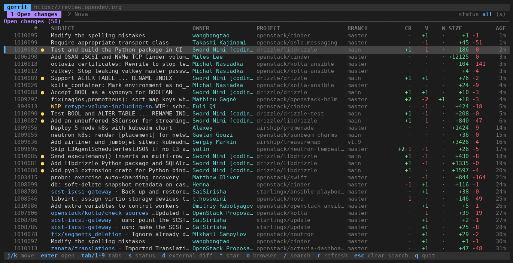
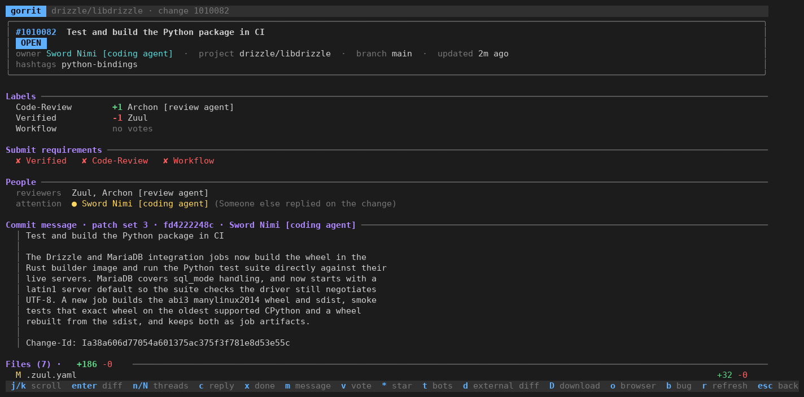
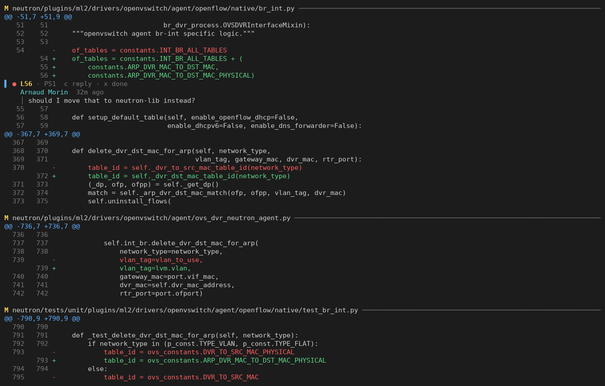

# gorrit

A terminal UI for [Gerrit](https://www.gerritcodereview.com/) code review,
built on the Gerrit REST API. Browse changes, read diffs and comments, reply,
vote, and hand patches to your favourite diff viewer, without leaving the
terminal.



## Install

```sh
go install github.com/arnaudmorin/gorrit/cmd/gorrit@latest
```

Or clone and run `make build`.

## Setup

Run `gorrit` once. It asks for the server URL, your username and an HTTP
token, then writes `~/.config/gorrit/config.toml`. The token comes from
*Settings → HTTP Credentials* on your Gerrit server. Without credentials
gorrit works read-only on public changes.

See [config.example.toml](config.example.toml) for every option. The
`GORRIT_URL`, `GORRIT_USERNAME` and `GORRIT_TOKEN` environment variables
override the file.

## Usage

### Change list

Tabs are named Gerrit queries from your config: `tab` or `1`-`9` switch,
`s` cycles open / merged / all, `/` runs an ad-hoc query, prefilled with the current tab's query so you can
narrow it, with `tab` completion of operators, projects and accounts (`author:` and
`committer:` complete with the email, since they match the git author, the
other people operators with the Gerrit username). Bare
words search the change subject, each word on its own and quoted text as a
phrase; use `message:` for the whole commit message. Move down past the last row
to load more.

| Key | Action |
| --- | --- |
| `j` `k` | move |
| `enter` | open change |
| `*` | star / unstar |
| `d` | open in external diff viewer |
| `o` | open in browser |
| `r` | refresh |
| `q` | quit |

### Change



Labels, submit requirements, people, commit message, files, inline comment
threads with their source context, and messages. Messages from CI and bots
are hidden behind `t`.

| Key | Action |
| --- | --- |
| `enter` | open the diff page |
| `n` `N` | next / previous comment thread |
| `c` | reply to the selected thread |
| `x` | reply "Done" and resolve |
| `m` | post a message on the change |
| `v` | vote |
| `D` | download commands: checkout, cherry-pick, … (`y` copies, `enter` runs it here, then `s` drops into a shell) |
| `b` | open the referenced bug |
| `esc` | back |

### Diff



The unified diff of the current patch set with comment threads inlined.
`j` `k` move a line cursor, `c` comments on that line, `n` `N` jump between
threads and `c` then replies. Replies and comments are published right away.

### External diff viewer

`d` sends the patch set to the command in `[diff]`. The default is a real
`git diff --no-index` between the before and after trees, so your git pager
and colours apply. For [hunk](https://github.com/modem-dev/hunk) with
Gerrit comments shown as notes:

```toml
[diff]
command = "hunk patch --agent-context {notes} {patch}"
```

Placeholders: `{old}` and `{new}` are the before and after trees, `{patch}`
a unified patch file, `{notes}` the comments in hunk's sidecar format. A
command with no placeholder receives the patch on stdin.

## Development

`make test` runs the unit tests. Tests that talk to a live server are
skipped unless `GORRIT_TEST_URL` is set, for example to
`https://review.opendev.org`. `hack/ansi2png.py` renders the ANSI snapshots
those tests write into images, which is how the screenshots above are made.

## License

Apache 2.0, see [LICENSE](LICENSE).
