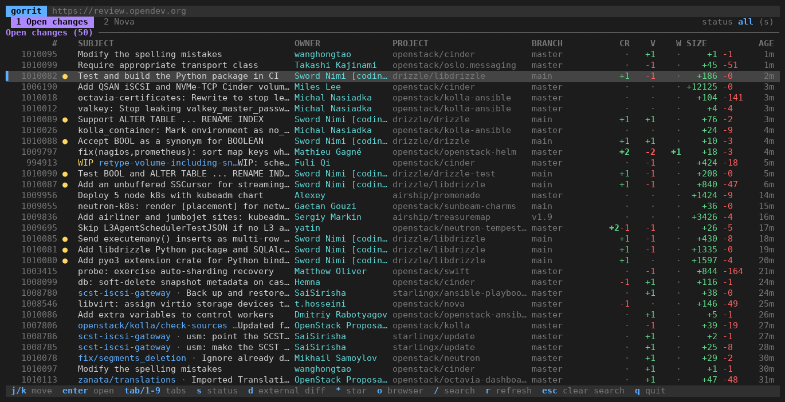
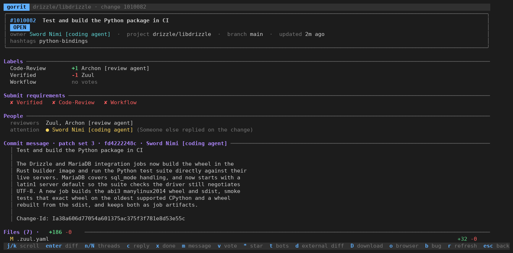
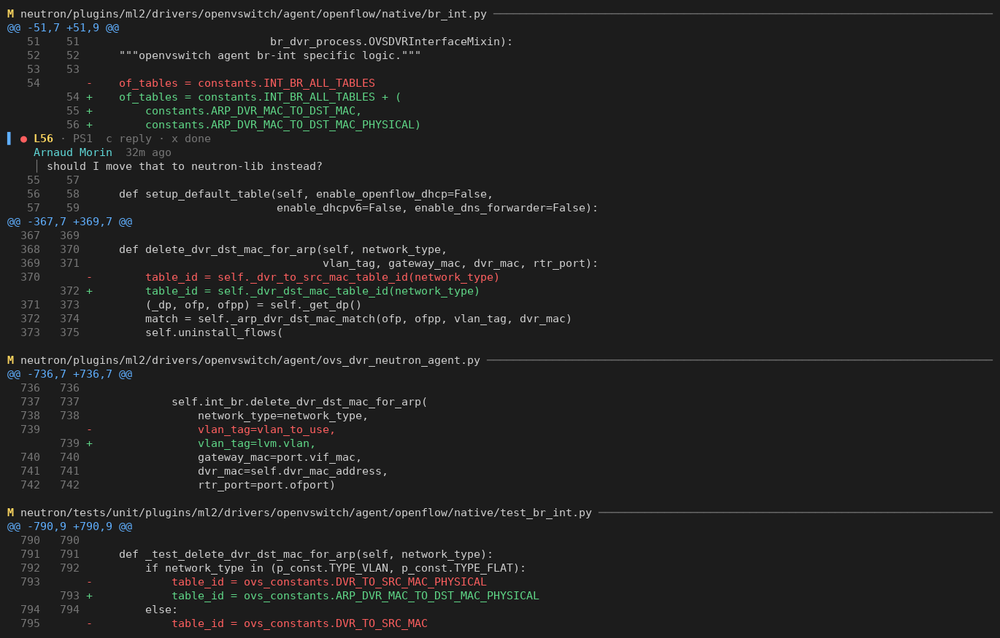

# gorrit

A terminal UI for [Gerrit](https://www.gerritcodereview.com/) code review,
built on the Gerrit REST API. Browse changes, read diffs and comments, reply,
vote, and hand patches to your favourite diff viewer, without leaving the
terminal.



## Install

```sh
go install github.com/arnaudmorin/gorrit/cmd/gorrit@latest
```

Or grab a binary from the [releases](https://github.com/arnaudmorin/gorrit/releases),
or clone and run `make build`.

## Setup

Run `gorrit` once. It asks for the server URL, your username and an HTTP
token, then writes `~/.config/gorrit/config.toml`. The token comes from
*Settings → HTTP Credentials* on your Gerrit server. Without credentials
gorrit works read-only on public changes.

See [config.example.toml](config.example.toml) for every option. The
`GORRIT_URL`, `GORRIT_USERNAME` and `GORRIT_TOKEN` environment variables
override the file.

## Usage

### Change list

Tabs are named Gerrit queries from your config: `tab` or `1`-`9` switch,
`s` cycles open / merged / all, `/` runs an ad-hoc query, prefilled with the current tab's query so you can
narrow it, with `tab` completion of operators, projects and accounts (`author:` and
`committer:` complete with the email, since they match the git author, the
other people operators with the Gerrit username). The first `tab` fills in
what all candidates share, the next ones cycle through them. Bare
words search the change subject, each word on its own and quoted text as a
phrase; use `message:` for the whole commit message. Move down past the last row
to load more.

Changes in a relation chain show their place in it before the subject, `1/3`
being the bottom of a chain of three, coloured per chain so its members stand
out.

| Key | Action |
| --- | --- |
| `j` `k` | move |
| `enter` | open change |
| `*` | star / unstar |
| `d` | open in external diff viewer |
| `a` | AI review, see below |
| `o` | open in browser |
| `r` | refresh |
| `q` | quit |

### Change



Labels, submit requirements, people, commit message, files, inline comment
threads with their source context, and messages. Messages from CI and bots
are hidden behind `t`.

| Key | Action |
| --- | --- |
| `]` `[` | step forward / back: summary, diff against the parent, then against each older patch set |
| `n` `N` | next / previous comment thread |
| `c` | reply to the selected thread |
| `x` | reply "Done" and resolve |
| `m` | post a message on the change |
| `v` | vote |
| `a` | AI review |
| `D` | download commands: checkout, cherry-pick, … (`y` copies, `enter` runs it here, then any key returns or `s` drops into a shell; `t` checks out into a throwaway shallow repo with `origin` set and opens a shell there) |
| `b` | open the referenced bug |
| `esc` | back |

### Diff



The commit message, then the unified diff of the current patch set with
comment threads inlined.
`j` `k` move a line cursor, `c` comments on that line, `n` `N` jump between
threads and `c` then replies. Replies and comments are published right away.

`]` opens the diff against the parent. On a change with several patch sets,
`]` then compares the current patch set with the previous one, then with
each older one, and `[` steps back to the summary. Against an older patch
set only the new side takes comments. `esc` returns to the summary.

### External diff viewer

`d` sends the patch set to the command in `[diff]`. The default is a real
`git diff --no-index` between the before and after trees, so your git pager
and colours apply. For [hunk](https://github.com/modem-dev/hunk) with
Gerrit comments shown as notes:

```toml
[diff]
command = "hunk patch --agent-context {notes} {patch}"
```

Placeholders: `{old}` and `{new}` are the before and after trees, `{patch}`
a unified patch file, `{notes}` the comments in hunk's sidecar format. A
command with no placeholder receives the patch on stdin.

### AI review

`a` in the list, the summary or the diff asks an AI tool to review the
current patch set. It runs in the background: the list row shows a spinner,
then `✓ claude` when the review is done (`✓ claude ps2` once a newer patch
set is up, `✗` when the command failed). The review appears on the summary
page under the commit message and is kept in your cache directory across
runs. Nothing is posted to Gerrit.

Findings written as `path:line: remark` (the line in the new file) also
show in the diff under that line, marked `✦ claude`. The default prompt asks
for that form; a custom command should too. Notes only show while the review
matches the current patch set.

A `Verdict: +1` or `Verdict: -1` line in the review shows next to the
marker in the list, `✓ claude +1`, and in the title of the review on the
summary page.

The command and its label are set in `[review]`, with the same placeholders
as `[diff]`; what it prints is the review. The default is:

```toml
[review]
name = "claude"
command = 'claude -p "Review this Gerrit change, its patch is on stdin. ... ending with a line Verdict: +1 or Verdict: -1. Then give each finding as its own paragraph starting with path:line: ..."'
```

## Development

`make test` runs the unit tests. Tests that talk to a live server are
skipped unless `GORRIT_TEST_URL` is set, for example to
`https://review.opendev.org`. `hack/ansi2png.py` renders the ANSI snapshots
those tests write into images, which is how the screenshots above are made.

## Releasing

Run `hack/release.sh patch` (or `minor`, `major`, or an explicit `vX.Y.Z`)
on an up-to-date master. It runs the tests, asks for confirmation, then
creates and pushes the `v*` tag. GitHub Actions runs the tests again and
publishes a release with Linux and macOS binaries through GoReleaser.

## License

Apache 2.0, see [LICENSE](LICENSE).
